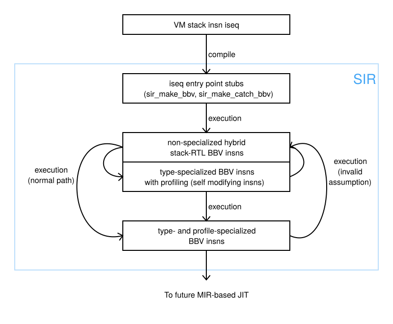

# What's the branch about

* The branch `sir-mirjit` is used for development of **specialized** VM insns (specialized IR or **SIR** in brief),
  **faster CRuby interpreter** and MIR-based JIT (**MIRJIT** in brief) based on SIR

* The last branch merge point with the trunk is always the head of the
  branch `sir-mirjit-base`
    * The branch `sir-mirjit` will be merged with the trunk from
      time to time and correspondingly the head of the branch
      `sir-mirjit-base` will be the last merge point with the trunk


## Specialized VM insns

* Specialized VM insns are generated dynamically in a lazy way and on VM insns BB level only.  They consist of
  * hybrid stack-RTL insns:
```
        sir_{plus,minus,mult,div,mod,or,and,eq,neq,lt,gt,le,ge,aref,aset}s{s,v,i}{s,v,i}
```
    where suffix `s` means value on stack, `v` means local variable value, `i` means immediate value.
    Some sufix combinations (like `vii`, `sii`, `sss`) are not permitted.
  * type-specialized insns:
```
        sir_i{plus,minus,mult,div,mod,or,and,eq,neq,lt,gt,le,ge,aref,aset}{s,v}{s,v,i}{s,v,i}
        sir_f{plus,minus,mult,div,mod,eq,neq,lt,gt,le,ge}{s,v}{s,v,i}{s,v,i}
```
    where `i` after prefix `sir_` means fixnum insns, and `f` means flonum insns
  * insns for profiling (e.g. `sir_inspect_type`)
  * type guards (e.g. `sir_check_fixtype`)
  * different specialized insns for calls (e.g. `sir_iseq_send_without_block` or `sir_cfunc_send`)
  * attribute manipulation (e.g. `sir_send_ivget` or `sir_send_ivset`)
  * iterators (`sir_iter_{start,body,cont}`)
  * different rarely executed insns to start generation of the specialized IR (e.g `sir_make_bbv`)
    or jitting (e.g. `sir_bbv_jit_call`).
* More details about specialized insns can be found at the end of file `insns.def`

## Project related files

* SIR generation related code can be found in file `sir_gen.c`
* SIR execution related code can be found in file `sir_exec.c` and `insns.def`
* MIRJIT code generation is in file `mirjit.c`
  * to build MIRJIT you need to build and install MIR-library from branch `bbv`
    of MIR project (`https://github.com/vnmakarov/mir`)

## SIR flow



* Normal IR execution flow:
  * Start execution of BB with a stub
  * Stub execution generates hybrid stack-based RTL insns and type-specialized insns with profiling insns
    * Type specialized insns here are generated by basic block versioning (see [article](https://arxiv.org/abs/1411.0352) by Maxime Chevalier-Boisvert)
  * Several executions of type-specialized insns results in type- and profile- specialized insns
  * Type- and profile-specialized insns are a source of MIRJIT
* Exception IR execution flow:
  * Switching to non-type specialized stack-based RTL

## Current state of the project

* The code is made public only for introducing CRuby developers to the project
* The code is only good enough to run optcarrot and micro-benchmarks from directory `sir-bench`
* The status will be changed to reflect the project progress

## The current performance SIR interpreter and MIRJIT

* All measurements are done on Intel i7-9700K with 16GB memory under
  x86-64 Fedora Core32

* I compared the following:
    * base - the base interpreter (`miniruby`)
    * sir - the interpreter with specialized (`miniruby --sir`)
    * yjit - YJIT (`miniruby --yjit-call-threshold=1`)
    * mjit - MJIT (`miniruby --jit-min-calls=1`)
    * mir - MIR-based JIT (`miniruby --mirjit`)

* I used the following micro-benchmarks (see MJIT-benchmarks directory):
    * aread - reading an instance variable through attr_reader
    * aref - reading an array element
    * aset - assignment to an array element
    * awrite - assignment to an instance variable through attr_writer
    * bench - rendering
    * call - empty method calls
    * complex-mandelbrot - complex mandelbrot
    * const2 - reading Class::Const 
    * const - reading Const
    * fannk - fannkuch
    * fib - fibonacci
    * ivread - reading an instance variable (@var)
    * ivwrite - assignment to an instance variable
    * mandelbrot - (non-complex) mandelbrot as CRuby v2 does not support complex numbers
    * meteor - meteor puzzle
    * nbody - modeling planet orbits
    * nest-ntimes - nested ntimes loops (6 levels)
    * nest-while - nested while loops (6 levels)
    * norm - spectral norm
    * pent - pentamino puzzle
    * red-black - Red Black trees
    * sieve - Eratosthenes sieve
    * trees - binary trees
    * while - while loop

* Each benchmark ran 3 times and minimal time (or smallest maximum resident memory) was chosen

* I also used optcarrot for more serious program performance comparison
    * I used **3000** frames to run optcarrot

## Microbenchmark results

* Wall time speedup:

|                     | base   | sir    | yjit   | mjit   | mir    |
:---------------------|-------:|-------:|-------:|-------:|-------:|
aread.rb              | 1.0    | 3.27   | 4.5    | 2.48   | 4.83   |
aref.rb               | 1.0    | 3.61   | 3.74   | 3.68   | 3.94   |
aset.rb               | 1.0    | 2.34   | 2.36   | 2.45   | 4.04   |
awrite.rb             | 1.0    | 2.85   | 3.23   | 2.12   | 4.59   |
bench.rb              | 1.0    | 1.21   | 1.5    | 1.19   | 1.25   |
call.rb               | 1.0    | 2.17   | 3.69   | 6.78   | 3.26   |
complex-mandelbrot.rb | 1.0    | 1.14   | 1.39   | 1.21   | 1.07   |
const2.rb             | 1.0    | 2.77   | 3.59   | 6.65   | 4.3    |
const.rb              | 1.0    | 2.77   | 3.58   | 6.65   | 4.31   |
fannk.rb              | 1.0    | 1.1    | 0.99   | 1.12   | 1.14   |
fib.rb                | 1.0    | 1.87   | 3.81   | 2.99   | 2.81   |
ivread.rb             | 1.0    | 2.06   | 2.84   | 4.07   | 3.06   |
ivwrite.rb            | 1.0    | 2.65   | 2.39   | 4.03   | 3.73   |
mandelbrot.rb         | 1.0    | 1.35   | 1.6    | 1.27   | 1.37   |
meteor.rb             | 1.0    | 1.23   | 1.31   | 1.07   | 1.23   |
nbody.rb              | 1.0    | 1.33   | 1.44   | 1.36   | 1.24   |
nest-ntimes.rb        | 1.0    | 1.87   | 1.15   | 1.31   | 1.89   |
nest-while.rb         | 1.0    | 4.54   | 3.88   | 3.9    | 6.25   |
norm.rb               | 1.0    | 1.35   | 1.53   | 1.3    | 1.5    |
pent.rb               | 1.0    | 0.98   | 1.0    | 1.04   | 0.96   |
red-black.rb          | 1.0    | 1.4    | 2.76   | 0.85   | 1.63   |
sieve.rb              | 1.0    | 1.85   | 2.29   | 2.09   | 2.47   |
trees.rb              | 1.0    | 1.22   | 1.7    | 1.17   | 1.31   |
while.rb              | 1.0    | 4.3    | 2.7    | 5.13   | 5.55   |
GeoMean.              | 1.0    | 1.93   | 2.22   | 2.19   | 2.38   |

---

* CPU time improvements is aprroximately the same except MJIT which has lower CPU time improvement

---

* Geomean max resident memory increase relative to the base interpreter:

|                     | base   | sir    | yjit   | mjit   | mir    |
:---------------------|-------:|-------:|-------:|-------:|-------:|
GeoMean.              | 1.0    | 1.04   | 13.0   | 3.04   | 1.96   |

---

## Optcarrot results

* Frame per seconds (more is better):

|                                  | base   | sir    | yjit   | mjit   | mir    |
:----------------------------------|-------:|-------:|-------:|-------:|-------:|
optcarrot                          | 47.5   | 65.8   | 89.5   | 119.3  | 74.9   |
optcarrot --opt                    | 156.8  | 212.5  | 22.2   | 164.1  | 214.9  |
